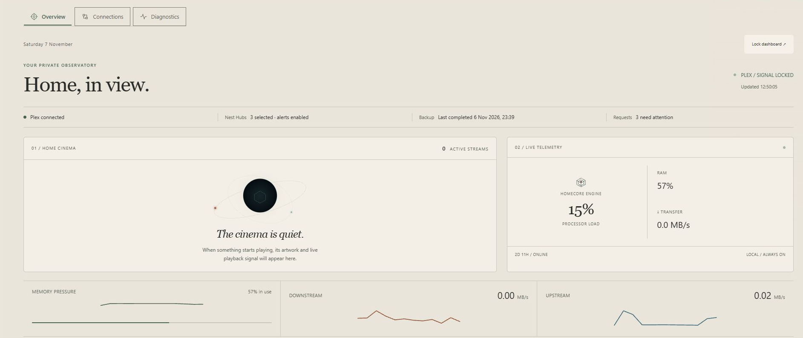
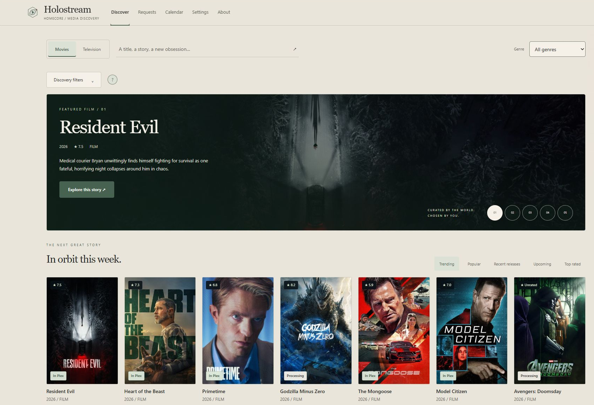
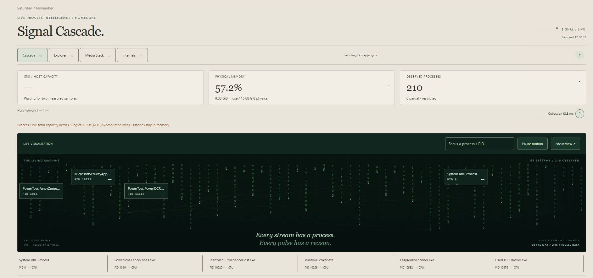

# HomeCore

HomeCore brings my server health, Plex activity, storage and media tools into one place. I can check how the server is doing, find something to watch and follow media requests from an interface built around my home setup.

*The dashboard puts server health alongside Plex activity. The cinema panel is quiet because nothing is playing.*

## Why I built it

I wanted a personalised way to manage the most important parts of my media stack, suited to my hardware and taste. HomeCore brings those pieces together in a place that feels like my own.

## Checking the server

I can see processor and memory use, network activity, uptime and storage warnings without switching between tools. Recently added films and episodes sit alongside requests that need attention and recent alert deliveries.

Storage monitoring helps me spot drives that are getting full or cannot be reached. An inaccessible drive needs checking; it does not necessarily mean it has failed.

## Finding something to watch

Holostream is my film and television browser inside HomeCore. I can search, browse shelves and filter titles, then see what is already in Plex or follow a request through approval and processing.

*“In Plex” shows what is available to watch; “Processing” helps me keep track of requests.*

TMDb supplies film and television information, while Plex tells HomeCore what is in my library. Connected Radarr and Sonarr installations handle approved movie and television requests. The calendar brings upcoming media and its status into view, and requests needing attention stay easy to find.

## Seeing what is running

Signal Cascade gives me a live view of what is running on the server. I can watch activity in its animated view or use Explorer to search and sort the list of programs.

*The visual view helps me explore activity, with named programs I can select for a closer look.*

Media Stack groups the media applications I have configured so I can check them together. Internals shows HomeCore's own activity. These views help me inspect the server without stopping or changing its programs.

## Looking back and keeping things in view

Archive Intelligence lets me explore the playback history recorded by Tautulli, the application that keeps track of Plex viewing. Timelines, calendars and title views give me different ways to look back through that history. Playback totals can include several people watching at once.

HomeCore also reaches beyond the browser. It can send storage and Plex image alerts to selected Nest Hubs, prepare a grayscale page for a compatible Kindle wall display and supply server information to my Rainmeter desktop widget. The Nest Hub alerts use casting, so their behaviour depends on the receiving device.

## A typical visit

I start with the dashboard to check health and storage, then look at Plex activity or recently added titles. From there I can browse in Holostream, follow a request or open Signal Cascade to understand what the server is busy with.

When I need a reminder about a setting or feature, the Operator's Manual provides searchable guides and help alongside what I am doing.

## Availability

HomeCore is a working personal project. This page showcases it; the application is not currently available to download here. Its connected displays need compatible hardware and their own setup.

## Technology

Python, FastAPI and SQLite, with an HTML, CSS and JavaScript browser interface. Pillow renders display images, PyChromecast handles Cast connections and Apache ECharts draws the viewing-history charts.
